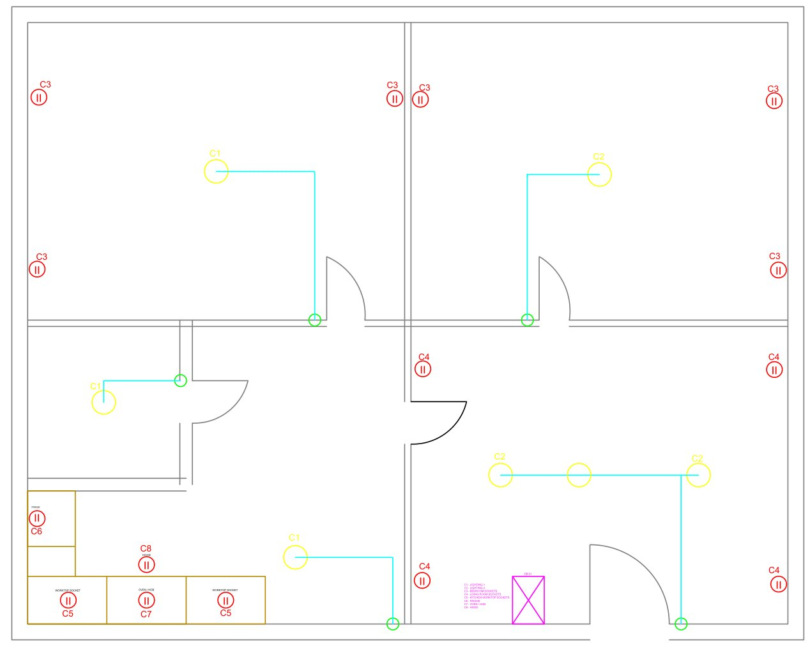
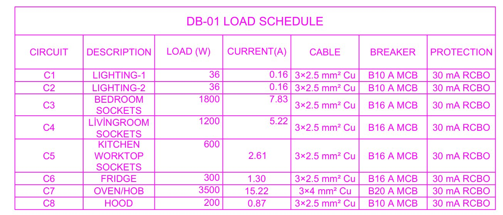
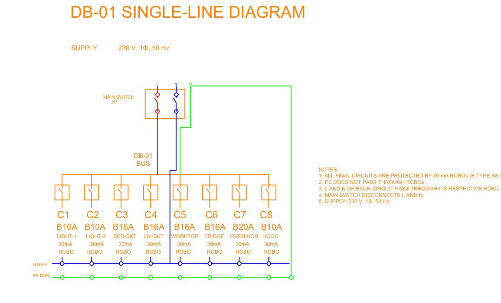
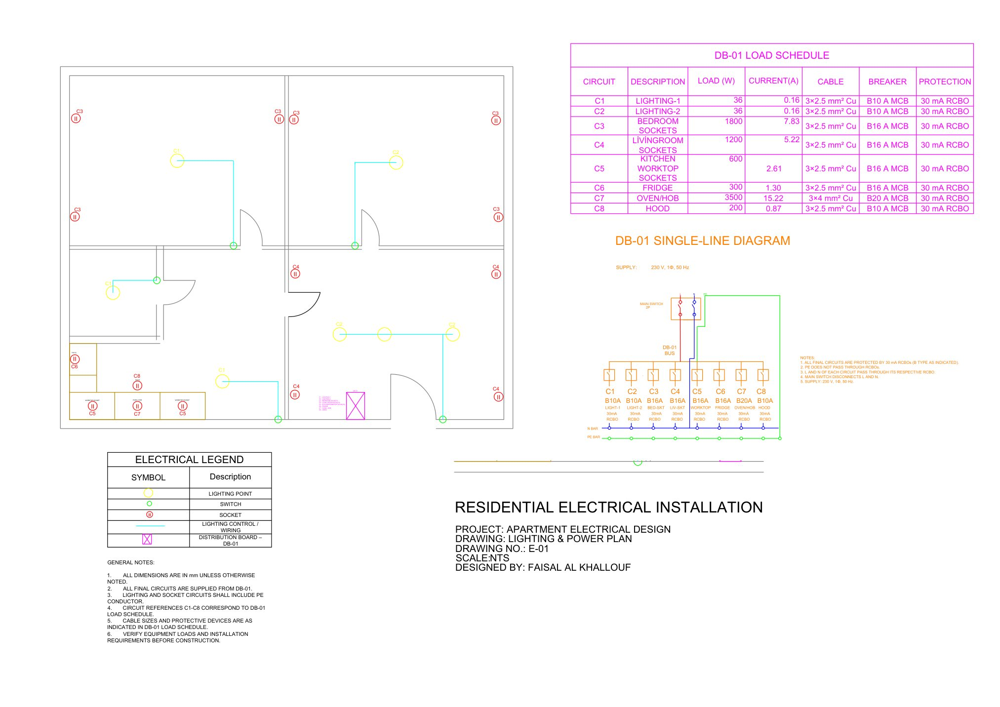

# Residential Electrical Installation Design

**Electrical MEP Design & Drafting | Autodesk AutoCAD | Self-Directed Engineering Portfolio Project**

A compact electrical design and drafting exercise for an approximately **80 m² two-bedroom residential apartment**. The work combines lighting and socket-outlet layouts, basic circuit load calculations, distribution board documentation, an electrical legend, and a simplified single-line diagram in a coordinated **A3 drawing sheet (E-01)**.

> **Project status:** Completed as a **conceptual educational/portfolio exercise**. The drawings are **not issued for construction**; final protection coordination, cable selection, electrical safety and local code compliance have not been verified.

*Figure 1 — Residential lighting and socket-outlet floor plan, with circuits C1–C8 identified.*

## Project at a glance

| Item | Project value |
| --- | --- |
| Building type | Two-bedroom residential apartment |
| Approximate overall footprint | 10,000 × 8,000 mm (80 m²) |
| Nominal electrical supply | 230 V AC, single phase, 50 Hz |
| Distribution board | DB-01 |
| Final circuits | 8 (C1–C8) |
| Lighting points | 6, divided into two lighting circuits |
| Total connected load | 7,672 W (7.672 kW) |
| Arithmetic current at 230 V, PF=1 | Approximately 33.36 A (not a demand-based feeder current) |
| Drawing reference | E-01 |
| Drawing format | A3 landscape, title block **NTS** |
| Software | Autodesk AutoCAD |

## Electrical drawing package

### 1. Lighting and power layout

The electrical floor plan identifies lighting points, switches, bedroom/living-room sockets and kitchen appliance connections. Circuit identifiers correspond to the distribution board schedule.

### 2. DB-01 load schedule

The eight final circuits include lighting, general-purpose socket outlets, kitchen worktop outlets, refrigerator, oven/hob and extractor hood connections.

The schedule lists nominal connected loads, calculated currents, preliminary cable sizes and protective-device ratings. The **7,672 W** connected total is not demand-adjusted. [See full circuit table](docs/load-schedule.md).

### 3. Simplified single-line diagram

The single-line diagram represents a single-phase incoming supply, two-pole main switch, outgoing circuits, protective devices, neutral bar and protective-earth bar.

### 4. Complete drawing sheet

[**Open complete A3 drawing PDF**](drawings/Residential_Electrical_Design_Faisal_Al_Khallouf.pdf) · [**Open Model-space PDF export**](drawings/MEP_Electrical_Mini_Project-Model.pdf)

## Original AutoCAD files

- [**Download/edit the original DWG**](source/MEP_Electrical_Mini_Project.dwg)
- [Final A3 electrical drawing PDF](drawings/Residential_Electrical_Design_Faisal_Al_Khallouf.pdf)
- [Model-space PDF](drawings/MEP_Electrical_Mini_Project-Model.pdf)

The PDF files are useful for viewing without AutoCAD; the DWG is the editable drawing source.

## Engineering approach

1. Prepared an apartment floor plan and allocated lighting/power outlets.
2. Grouped the apartment load points into eight identified final circuits.
3. Calculated nominal currents using **I = P / V** with a simplified unity power factor assumption.
4. Organized connected loads and preliminary cable/breaker selections in the **DB-01 load schedule**.
5. Drew a simplified distribution board **single-line diagram**.
6. Prepared the electrical symbols, annotations, general notes and A3 presentation sheet.

## Files and documentation

| File | Purpose |
| --- | --- |
| [Circuit load schedule](docs/load-schedule.md) | Circuit details and basic calculation notes |
| [Drawing index](docs/drawing-index.md) | Description of each drawing and original file |
| [Design limitations](docs/design-limitations.md) | Important engineering qualifications and items requiring verification |
| [Machine-readable load schedule](data/db01-load-schedule.csv) | Circuit and nominal load data in CSV format |

## Skills demonstrated

AutoCAD electrical drafting · Electrical MEP design fundamentals · Lighting and outlet layout · Circuit identification · Basic load/current calculations · Distribution board schedules · Single-line diagrams · Drawing documentation

## Portfolio

[**View the public Engineering Portfolio on Notion**](https://guttural-galliform-d52.notion.site/Engineering-Portfolio-414920417b9d8034a902d6caa11becf1)

## Engineering note

The drawing schedule includes preliminary B-curve breaker ratings, cable sizes and **30 mA RCBO** references. These are design-study entries, not a demonstration of verified installation suitability. No final demand factor, voltage-drop calculation, installation-method derating, short-circuit study, selectivity check or compliance assessment is documented. The title block identifies scale as **NTS**, although a separate written project report refers to a nominal 1:50 floor plan.

---

**Designed by Faisal Al Khallouf** · **September 2026** · **Self-directed educational project**
